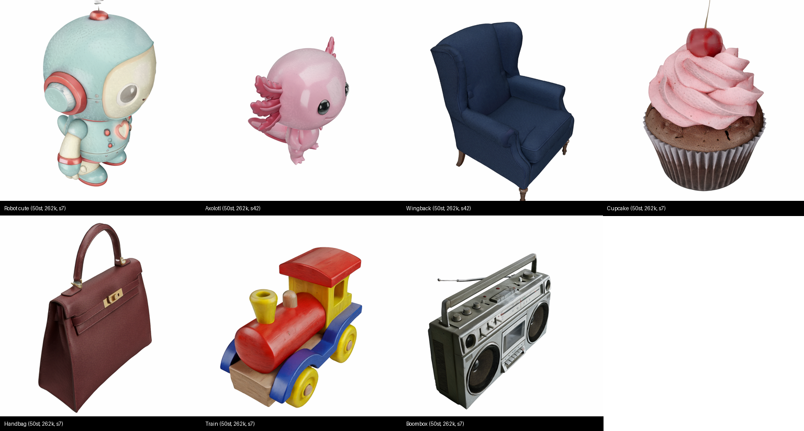

# ComfyUI-Idol

[](https://github.com/comfyanonymous/ComfyUI)
[](LICENSE)
[](https://www.python.org)
[](#measured-rtx-4090-24-gb-comfyui-0420)
[](https://huggingface.co/speridlabs/idol)

Single image → 3D Gaussian splat inside ComfyUI, wrapping [`speridlabs/idol`](https://huggingface.co/speridlabs/idol).

One picture of an object in; 32,768 – 1,048,576 Gaussians out, including the sides the picture never showed.
Outputs a native ComfyUI `SPLAT`, so the core `RenderSplat` / `SplatToFile3D` / `SplatToMesh` nodes handle
viewing, turntables and export — no separate viewer, no file round-trip.



*Every tile is a single input image turned into a splat and rendered by core `RenderSplat` — no manual cleanup.*

## Install

**Manual**

1. Clone into `ComfyUI/custom_nodes`:

   ```
   git clone https://github.com/Brie-Wensleydale/ComfyUI-Idol
   ```

2. Two pure-python deps. `--no-deps` matters — `tensordict` publishes torch-versioned wheels and a plain install
   can swap the torch in your portable build:

   ```
   python_embeded\python.exe -m pip install --no-deps tensordict plyfile
   ```

3. Restart ComfyUI, then drag one of the example graphs onto the canvas:

   - `example_workflows/idol_simple.json` — LoadImage → Idol → one rendered frame → SaveImage (5 nodes)
   - `example_workflows/idol_turntable.json` — the same plus a 24-frame turntable and the preprocessed image (6 nodes)

**Weights** download automatically on the first run of **Idol Loader** (~6.8 GB):

   | file | where | size |
   |---|---|---|
   | `config.json`, `denoiser`, `decoder`, `decoder_gs`, `birefnet` | `models/idol/` | 3.08 GB |
   | `dinov3_vith16plus.safetensors` (DINOv3 ViT-H/16+ encoder) | `models/idol/` | 3.36 GB |
   | `flux2-vae.safetensors` (FLUX.2 VAE encoder) | `models/vae/` | 0.34 GB |

   The DINOv3 weights come from the ungated `timm/vit_huge_plus_patch16_dinov3.lvd1689m` mirror and the FLUX.2
   VAE from `Comfy-Org/Flux-2-Dev`, so **no Hugging Face access requests are needed**. If the VAE already exists in
   `models/vae/` it is reused (its ComfyUI-format keys are remapped to diffusers in memory).

## Nodes

**Idol Loader** → `IDOL_PIPELINE`. Keeps the pipeline cached between runs (≈3.7 GB VRAM resident).

**Idol Image to Splat** (`IDOL_PIPELINE`, `IMAGE`, optional `MASK`)

| input | default | notes |
|---|---|---|
| `mode` | synthetic | `synthetic` for renders/generated images (crop 1.2), `real` for photos (crop 1.7) |
| `steps` | 50 | CFG doubles cost: 50 steps = 100 DiT passes |
| `cfg_strength` | 3.0 | how strictly the object follows the image |
| `rescale_t` | 3.0 | time shift toward the overall shape |
| `seed` | 42 | deterministic per seed |
| `num_gaussians` | 262144 | 32768 … 1048576 (the whole range costs the same VRAM) |
| `crop_margin` | 0 | 0 = the mode's default |
| `save_ply` | on | writes a standard 3DGS `.ply` to `output/idol/` |
| `unload_after_run` | off | offloads the pipeline (frees 3.7 GB) when the run ends |
| `mask` | – | object alpha, white = keep; skips BiRefNet background removal |

Outputs: `splat` (SPLAT), `preprocessed` (the 1024² image the model saw), `ply_path` (STRING, the written .ply).

**Idol Preprocess** — the preprocessed 1024² image alone, useful for debugging a crop.
**Idol Unload VRAM** — drops the cached pipeline (3.7 GB) when you are done.

## Measured on an RTX 4090 (24 GB)

| | |
|---|---|
| generation, 50 steps / 262,144 gaussians | **27–31 s** |
| whole graph incl. a 24-frame turntable | **54–59 s** |
| generation, 1,048,576 gaussians | **31 s** (+4 s) |
| peak VRAM | **7.2 GB** reserved / 5.35 GB allocated, at every gaussian count |
| resident when loaded | 3.7 GB (0.01 GB after unload, 1.1 s to reload) |
| cold pipeline load | ~36 s |
| `.ply` size | 17.8 MB @ 262k, 71.3 MB @ 1M |

The node asks ComfyUI for 9 GB before running, so other models are evicted rather than OOM-ing mid-graph.

## Wiring

```
LoadImage ──► Idol Image to Splat ──► RenderSplat (frames=60) ──► video
                    │                      frames=1            ──► SaveImage
                    └──► SplatToFile3D ──► .ply / .splat
```

## How it works

Idol is a 1.80B-parameter image-to-3D model. One image is preprocessed, read by two encoders, and denoised into
Gaussians by a DiT and two decoders.

| Component | Parameters | Precision | Weights in VRAM |
|---|---|---|---|
| DiT (denoiser) | 370.6M | FP16 blocks, FP32 embeddings/norms | ~0.8–1.0 GB |
| Octree decoder | 50.8M | FP16 blocks, FP32 embeddings/norms | ~0.1–0.2 GB |
| Gaussian decoder | 237.3M | FP16 blocks, FP32 embeddings/norms | ~0.5–0.9 GB |
| BiRefNet (background removal) | 220.7M | FP16 | ~0.44 GB |
| DINOv3 ViT-H+/16 | 840.6M | bf16 | ~1.68 GB |
| FLUX.2 VAE | 84.1M | bf16 (FP32 checkpoint, cast on load) | ~0.17 GB |
| **Full request** | **~1.80B** | mostly FP16 / bf16 | **~3.7–4.4 GB, 7.2 GB peak** |

The stages this pack runs, in order:

1. **Preprocess** — short side scaled to 1024; BiRefNet is only invoked when the image has no alpha channel, then
   the alpha is eroded 1 px, the object is square-cropped (`synthetic` fills 1/1.2 of the frame, `real` 1/1.7) and
   composited on black.
2. **Encode** — DINOv3 produces 4,101 tokens (class token + 4 registers + 64×64 patches); the FLUX.2 VAE produces
   4,096 latent tokens, patchified 2×2 and padded with 5 zeros so both sequences line up.
3. **Sample** — Euler flow matching, 50 steps at cfg 3.0, `rescale_t` 3.0, on Gaussian noise plus a camera token.
   CFG means 50 steps is 100 DiT passes, which is where the run time goes.
4. **Decode** — the octree decoder allocates gaussians where the object is, the Gaussian decoder fills in
   position, scale, rotation, opacity and diffuse colour (SH degree 0). This pack hands those straight to
   `Types.SPLAT` instead of writing a `.ply` first.

## Upstream benchmark

From the [model card](https://huggingface.co/speridlabs/idol) — scored at the input view (PSNR, SSIM, LPIPS, IoU)
and at seven new views (DINOv2, CLIP, sharpness distance), mean scores, 1 × H100 per model, best in bold.

| Model | Setting | PSNR ↑ | SSIM ↑ | LPIPS ↓ | IoU ↑ | DINOv2 ↑ | CLIP ↑ | Sharpness ↓ |
|---|---|---|---|---|---|---|---|---|
| **Idol** | 50 steps, 262,144 Gaussians | 12.25 | **0.726** | **0.213** | **0.862** | **0.781** | **0.885** | **0.81** |
| TripoSplat | 50 steps, 262,144 Gaussians | 11.76 | 0.712 | 0.225 | 0.860 | 0.743 | 0.868 | 1.03 |
| TRELLIS | paper setting, 50 + 50 steps | 11.89 | 0.716 | 0.235 | 0.845 | 0.754 | 0.868 | 0.97 |
| LGM | default, 65,536 Gaussians | **12.46** | 0.722 | 0.237 | 0.834 | 0.575 | 0.784 | 1.22 |

LGM wins PSNR while looking visibly blurrier — PSNR averages squared pixel error.

A word on the timings you may have read: the model card quotes **19.1 s on an RTX 4090**. That is upstream's
optimised path (`torch.compile`, batched CFG passes, fp16 DINOv3). **This pack runs the released code path, so it
lands at 27–31 s here**, and pays the same 36 s model load the first time. The compile path is not wired in — it
trades ~4× the first-run compile time and extra VRAM for the speedup, which is a poor trade inside a node that
already evicts other models.

## What it cannot do

- **Single image only.** There is no multi-view input — unseen sides are invented by the model's prior, so wide
  orbits degrade into holes and smears. Model sheets and orthographic views cannot be fed in. For multi-view
  conditioning use Trellis 2 / Pixal3D (`TripoSplatConditioning` in core).
- **Diffuse colour only** (SH degree 0): metals, glass and polished surfaces read flat.
- **A splat, not a mesh** — no normals, UVs, texture or rig. Run `SplatToMesh` if you need geometry.
- **Thin features** — antennae, stems and wires collapse to a line of sparse Gaussians that vanishes edge-on.

## Troubleshooting

| Symptom | Cause and fix |
|---|---|
| `missing weights in models/idol` | `download_if_missing` is off — turn it on, or fetch the files from [speridlabs/idol](https://huggingface.co/speridlabs/idol). Partial downloads are detected by byte size and re-fetched. |
| First run hangs for ~40 s with no output | Expected: 3.7 GB of weights load from disk. Every run after that is cached. |
| `No module named tensordict` | The dependency step was skipped — see [Install](#install). |
| `pip` wants to replace torch | You dropped `--no-deps`. Reinstall it with `--no-deps` so the portable build's torch stays put. |
| CUDA OOM | Peak is 7.2 GB, so a card with ≥8 GB free is enough. Lowering `num_gaussians` will **not** help — the peak is flat across the whole range. Add **Idol Unload VRAM** after the run, or enable `unload_after_run`. |
| Nodes missing after install | ComfyUI must be restarted; check the console for `[idol]` lines and any import traceback. |
| Render is empty or very faint | `RenderSplat` needs `render_style=color`, `opacity_threshold=0.0`, `splat_scale=1.0`. `SplatToFile3D` is the way to export. |
| Photos come out cropped too tight | Use `mode=real` (crop 1.7 instead of 1.2), or set `crop_margin` explicitly. |
| Wide orbit angles look smeared | That is the model, not the node — it invents unseen sides. Keep orbits to roughly ±60° from the input view. |

## Acknowledgements

Thank you to the people who made this possible:

- **[Sperid Labs](https://speridlabs.com/research/idol)** — for Idol itself: the model, the Apache-2.0
  [idol-sdk](https://github.com/speridlabs/idol-sdk), the Hugging Face Space with its example gallery and the
  `presets.json` settings this pack's defaults follow, and a model card detailed enough to port from. Releasing the
  weights and SDK openly is what made a ComfyUI node a weekend's work instead of a research project.
- **[Meta AI](https://ai.meta.com/resources/models-and-libraries/dinov3-license)** — for DINOv3 ViT-H+/16, the
  image encoder that reads the input.
- **[Black Forest Labs](https://huggingface.co/black-forest-labs/FLUX.2-dev)** — for the FLUX.2 VAE.
- **[ComfyUI](https://github.com/comfyanonymous/ComfyUI)** — for the native `SPLAT` type and the
  `RenderSplat` / `SplatToFile3D` / `SplatToMesh` nodes. Without those this pack would need its own viewer.
- **[timm](https://github.com/huggingface/pytorch-image-models)** and Ross Wightman — for the ungated DINOv3
  mirrors, which let this pack avoid two gated Hugging Face repositories entirely.
- **[Hugging Face](https://huggingface.co)** — for hosting the weights.

## Credits & licence

This pack vendors the Apache-2.0 `idol` package from [speridlabs/idol-sdk](https://github.com/speridlabs/idol-sdk)
**unmodified**, under `idol/`; see `LICENSE` and `NOTICE`. The Idol weights are Apache-2.0.

The encoder weights are **not** Apache-2.0 and are **not** redistributed here: DINOv3 is Meta's
[DINOv3 licence](https://ai.meta.com/resources/models-and-libraries/dinov3-license), and the FLUX.2 VAE is under
the FLUX Non-Commercial licence. Local and private use is fine; do not publish a bundle containing them.

Modification to the vendored code: none. This pack substitutes its own encoder class at import time
(`idol.pipeline.ImageEncoder`) so DINOv3 and the FLUX.2 VAE load from local weights instead of the two gated
Hugging Face repositories the upstream code requests.

Not affiliated with Sperid Labs or Black Forest Labs.
